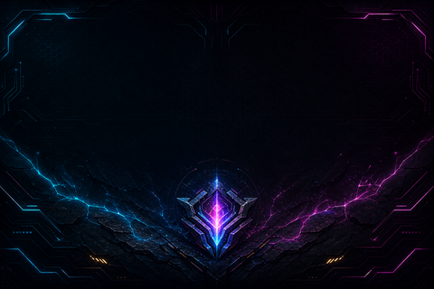
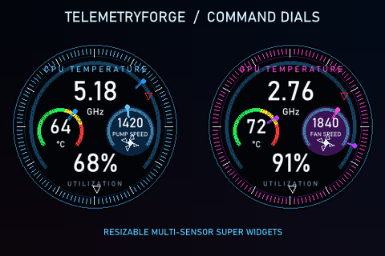

# TelemetryForge

An open-source Windows desktop application for TURZX/Turing Smart Screen
3.5-inch USB displays normally controlled by `UsbMonitor.exe`.

## Highlights

- Visual drag-and-drop screen editor with live preview
- Reusable YAML screen profiles
- CPU, GPU, RAM, VRAM, disk, network, fan, Windows volume and clock sensors
- Text, bars, circular gauges and historical graphs
- Per-widget fonts, gradients, opacity, glow, shadows and thresholds
- Multi-select, group movement, alignment and distribution
- Smooth animations and partial display updates
- Optional boot animation and premium screen-transition effects
- Share export with a `.telemetryforge` package and PNG preview
- Assignable Gaming, Minimal and Idle quick screens
- Automatic screen rules and configurable screen transitions
- English and Italian user interfaces
- System tray and Windows autostart

## Supported hardware

The current driver targets Turing/UsbMonitor revision A displays, including
devices identified as `USB35INCHIPSV2` or USB VID/PID `1a86:5722`.

- Serial speed: 115200 baud
- Flow control: hardware RTS/CTS
- Pixel format: RGB565 little-endian
- Typical resolutions: 480×320 landscape or 320×480 portrait

Always close `UsbMonitor.exe` before starting TelemetryForge.

## Requirements

1. Windows 10 or Windows 11
2. Microsoft Edge WebView2 Runtime
3. Rust stable with the recommended MSVC toolchain
4. The display serial driver, commonly CH340 or CH552
5. Optional: LibreHardwareMonitor or FanControl

```powershell
rustup default stable-x86_64-pc-windows-msvc
```

Node.js is not required.

## Development

```powershell
cargo run
```

Application data is stored in:

```text
%LOCALAPPDATA%\TelemetryForge
```

This includes `config.yaml`, saved screens and bundled samples. Legacy data
found next to the executable is migrated automatically. Windows autostart
loads the last active configuration and starts rendering in the system tray.
It uses an immediate Task Scheduler logon trigger instead of the delayed
`HKCU\Run` startup queue. In autostart mode, TelemetryForge does not create
the WebView2 editor window until you open it from the tray, reducing idle tray
memory usage.

## Release build

```powershell
cargo build --release
```

The executable is written to `target\release\TelemetryForge.exe`.

Every push to `main` publishes a numbered Windows build such as
`v0.3.0-build.17` and marks it as the GitHub Latest release. Stable milestones
continue to use semantic tags such as `v0.3.0`.

To create a Tauri installer:

```powershell
cargo install tauri-cli --version "^2"
cargo tauri build
```

## LibreHardwareMonitor

TelemetryForge automatically checks common LibreHardwareMonitor and FanControl
installation folders. You can also set an explicit DLL path:

```yaml
libre_hardware_monitor_dll: 'C:\Tools\LibreHardwareMonitor\LibreHardwareMonitorLib.dll'
```

The bridge runs through `scripts\read-lhm.ps1` in a hidden PowerShell process.
Some sensors may require administrator privileges.

## Screen editor

Screens are stored as YAML files inside the `screens` directory. Widgets can
be dragged, resized, multi-selected, aligned and evenly distributed.

The interface is split into **Editor** and **Setup** workspaces. Display,
Remote Deck security, automation and weather configuration live in Setup,
leaving the Editor focused on screen composition. The Layers panel can be
collapsed and remembers its state.

The Layers panel provides editable internal names, visibility, locking,
front/back ordering and groups. Groups move together and resize
proportionally. Undo/redo is available through the toolbar or `Ctrl+Z` and
`Ctrl+Y`. Preview labels are shown only for selected widgets.

Each widget supports:

- text before and after the sensor value;
- a separate Windows font;
- primary and secondary gradient colours;
- opacity, glow and shadow;
- warning and critical thresholds;
- text, bar, circle or historical graph rendering;
- independent position and dimensions.

### Network speed units

New network upload/download widgets use `{speed}` in **Text / format** to
automatically display Kbit/s, Mbit/s or Gbit/s, with up to one decimal place.
The unit is included: for example, `UP {speed}` displays `UP 570 Mbit/s`.
Zero displays `0 Kbit/s`; missing or invalid readings display `--`.

Existing screens keep their formats and positions. To opt an existing network
widget into automatic units, replace `{value}` with `{speed}` and remove any
fixed unit such as ` B/s` or ` KB/s` from **Right text** or the format itself.
Keep custom labels such as `UP` and `DOWN` in **Left text**.

`{value}` and `{value:.0}` still show the rounded raw sensor value, so existing
layouts, graph scales, histories and thresholds continue to work unchanged.
The raw values are historically labelled KB/s, but the sysinfo poller computes
bytes / 1024 / second (KiB/s). `{speed}` multiplies by 1024 and 8, then uses
decimal SI bit units: 69,580.078125 raw KB/s is 570 Mbit/s; 80,000 is
655.4 Mbit/s. Formatting does not change how interfaces are sampled or summed.
The editor preview and USB display use the same formatter. Older application
versions do not understand `{speed}`; use `{value} KB/s` when sharing a screen
with users of those versions.

Weather widgets are available for current temperature, humidity, wind speed
and a text condition. A separate scalable monochrome weather icon widget can
be styled with the normal colour, opacity, glow and shadow controls. Enable
weather data and enter decimal latitude/longitude
in the Weather panel. TelemetryForge uses Open-Meteo without an API key,
caches the last successful response and refreshes no more often than every
five minutes.

Weather data is provided by [Open-Meteo.com](https://open-meteo.com/) under
[CC BY 4.0](https://creativecommons.org/licenses/by/4.0/). The default
open-access endpoint is intended for non-commercial use; commercial
deployments should follow Open-Meteo's current API terms or self-host it.

Circular gauges also support thickness, start angle and sweep angle.

## Included sample

The **Telemetry** 480×320 screen adds cyan/amber CPU/GPU dials, compact histories,
temperatures and a RAM/VRAM/disk/volume strip. Import
[`samples/telemetry.telemetryforge`](samples/telemetry.telemetryforge).
See the [sample guide](samples/telemetry/README.md) for wallpaper customization.


The repository includes the **MSI Forged Core** 480×320 sample with its
background, circles, bars and historical graphs. Import
[`samples/msi-forged-core.telemetryforge`](samples/msi-forged-core.telemetryforge)
from the Screen panel. Its editable source files are in
[`samples/msi-forged-core`](samples/msi-forged-core).



## Super Widgets

Super Widgets combine multiple sensors and custom graphics into one movable
and resizable editor object.



Release builds include:

- **CPU Command Dial**
- **GPU Command Dial**
- **Reactor Core**
- **SDK Hello Dial**

Ready-to-use screen profiles are installed automatically when missing. Their
editable sources and standalone WASM packages are available in
[`samples/superwidgets`](samples/superwidgets).

The Command Dials combine frequency, temperature, utilisation and fan speed.
Component manifests are installed under
`%LOCALAPPDATA%\TelemetryForge\superwidgets`.

Super Widgets appear in the normal Widget picker. Each instance can choose its
own background colour/alpha and supported sensor bindings, such as CPU
Core/Socket temperature or a specific fan source.

External components can be written in Rust using the sandboxed WebAssembly
SDK in [`sdk`](sdk). They are distributed as `.superwidget` packages and
installed through **Import component**, without rebuilding TelemetryForge.
The SDK examples include **Reactor Core**, an animated dual-system telemetry
reactor built entirely as an external component. It demonstrates sensor-driven
arcs, independent gauges, dynamic values and low-cost 10 FPS animation.
See the complete [Super Widget SDK guide](sdk/README.md) for project structure,
the manifest format, available sensors and drawing APIs, animation guidance,
packaging and current ABI limitations.

The **System volume** widget reads the Windows default playback-device volume.
It can be displayed as text, a bar, a circle or a historical graph without
LibreHardwareMonitor.

## Automatic screens and transitions

Enable automation in the editor, choose an optional default screen and add
rules in priority order. The first matching rule wins. Rules can switch screen
when:

- a named process is running, such as `game.exe`;
- GPU temperature reaches a configured threshold;
- CPU temperature reaches a configured threshold;
- GPU or CPU usage stays above a configured percentage;
- the PC has been idle for a configured number of seconds.

Automatic rules continue running while TelemetryForge is hidden in the system
tray. Screen changes can use no transition, fade, slide, dissolve or glitch,
with a configurable duration. Each rule also has activation and return delays
to prevent brief workload spikes from repeatedly switching screens.

## Premium effects and sharing

Setup includes a toggleable boot animation that runs once during Windows
autostart. Manual **Start rendering** skips it, so the effect feels like a
real system power-on sequence instead of repeating while editing. The included
modes are Forge Core, Scanlines and Fade In, with a configurable duration. You
can optionally choose a saved screen, such as **TelemetryForge Boot**, as the
boot screen before TelemetryForge transitions to the current active screen.

The **Share** button exports the current screen as a `.telemetryforge`
package and writes a PNG preview next to it, making it easy to post a layout
on GitHub, Reddit or Discord.

## Background slideshow

The background source can be a solid colour, a single image, or a folder.
Folder mode cycles through supported images (`png`, `jpg`, `jpeg`, `bmp`,
`gif`, and `webp`) at a configurable interval in minutes. Images are sorted by
filename and selected automatically.

## Rendering engine

TelemetryForge keeps the COM port open during continuous rendering and sends
only changed display regions. Distant animated elements are divided into
independent small rectangles instead of forcing a large bounding-box update.

## Remote Deck LAN

TelemetryForge includes an embedded web version of the editor. While the
Windows application is running, open the address shown in its header, usually:

```text
http://192.168.1.x:8787
```

The remote editor supports live preview, drag-and-drop editing, screens,
widgets, Super Widgets, sensors, automation, brightness and rendering
controls. It uses the Windows PC for hardware sensors and USB display access.
Gaming, Minimal and Idle Quick Screen assignments are shared with the Windows
application.
The complete Remote Deck server can be enabled or disabled from the desktop
security panel; disabling it closes port `8787` without restarting the app.

The first Remote Deck MVP does not yet support browser uploads/downloads for
backgrounds, GIFs, screen packages or `.superwidget` packages. Use the Windows
application for those file operations.

### Sending text from an external service

Add a **Remote text** widget and give it a stable **Remote text key**, for
example `game-status`. An external service can then update it immediately with:

```powershell
Invoke-RestMethod -Method Post `
  -Uri "http://YOUR-PC-IP:8787/api/widget-text/game-status" `
  -ContentType "application/json" `
  -Body '{"text":"Race starts in 10 seconds"}'
```

The endpoint accepts up to 512 characters and returns JSON. If Remote Deck
authentication is enabled, send the same HTTP Basic username/password used by
the browser (for PowerShell: add `-Credential (Get-Credential)`). Incoming text
is held in memory only: it never overwrites the saved screen and is reset when
TelemetryForge exits.

For integrations, set a **text API token** (at least 16 characters) in Setup →
Remote Deck security. Send `Authorization: Bearer YOUR_TOKEN` with the POST.
This token can update text only; it cannot edit screens, read configuration or
control the display. Enable username/password authentication to require
credentials from other callers. Revoke the token using the checkbox in Setup.
Repeated identical text returns `changed: false` and never triggers transitions
or changes automation state. Up to 256 distinct text keys are held in memory.

### Reliability and portable packages

Configuration saves use atomic replacement and retain the previous valid YAML
as `config.yaml.bak` (saved screens have their own `.yaml.bak`). Invalid YAML can
be recovered from that backup on load.

Packages contain background images, GIFs, slideshow files, Super Widget modules
and custom font files explicitly selected by path. Installed Windows font
families remain references and are not automatically redistributed. Package
imports are bounded to 2048 entries and 256 MiB of extracted content.

The display renderer caches widget layers and honours their refresh intervals.
Animated GIFs and animated Super Widgets use their own FPS (display loop capped
at 20 FPS; USB throughput can lower the achieved rate), independently of slow
sensor frame settings. Static scenes skip unchanged frames and pending layers
wait until their refresh deadline. Hardware and weather polling run on a
separate worker. GIFs are limited to 64 MiB/2000 decoded frames each, with a
128 MiB shared cache. New configurations start with Remote Deck disabled;
existing users keep their saved setting.

Remote Deck authentication can be enabled from **Remote Deck security** in the
Windows application. Choose a username and a password of at least eight
characters. Passwords are stored only as Argon2 hashes. Once enabled, browsers
show their native username/password prompt before loading any page or API.

Until authentication is configured, use Remote Deck only on a trusted LAN.
Even with authentication enabled, do not forward port `8787` directly on your
router; encrypted remote access will be added separately. Windows may ask for
firewall permission on first launch—allow private networks only.

## Troubleshooting

### Live diagnostics and precise editing

Expand **Live diagnostics** below the preview. FPS means successful display
updates over the previous five seconds, not game FPS. USB timing includes dirty
region detection and transfer; the byte counter includes RGB565 pixels only.
Counters reset when rendering starts and exclude the startup animation.
Near-zero FPS is expected for a static scene. Timing values describe the last
render/transfer, not continuous CPU usage.

**Sensor health** uses cached readings without extra hardware polling. It shows
the provider, source-sampling age, missing readings and errors. A real zero is
not a missing reading. Missing readings in widgets show `--`; stale cached
weather remains available and is identified in diagnostics. Stop pauses normal
sensor polling; Test sensors explicitly requests a fresh sample.

Use **Snap grid** (off/4/8/16 px) and **Alignment guides** below the preview.
Guides snap to widget/display edges and centres. Hold Alt to bypass snapping.
Select a widget and use arrow keys for 1 px nudges, Shift+arrow for 10 px.
Groups move together; locked widgets stay fixed. Undo/redo applies to nudges.
These aids are editor-only and never appear on the USB display or exported PNG.

### Display not detected

- Close `UsbMonitor.exe`, including its tray process.
- Reconnect the USB data cable.
- Check Device Manager for a COM port.
- Install or update the serial driver.
- Enter the port manually, for example `COM3`.

### Missing sensor values

- Confirm LibreHardwareMonitor or FanControl can see the sensor.
- Verify the configured DLL path.
- Try running TelemetryForge as administrator.
- Use **Test sensors** to inspect available values.

## Protocol source

The protocol was researched from
[`turing-smart-screen-python`](https://github.com/mathoudebine/turing-smart-screen-python),
especially its revision A driver. TelemetryForge is an independent Rust
implementation.

## Releases and automated builds

Version tags such as `v0.3.0` create stable GitHub releases. Every push to
`main` also creates a separate numbered build such as `v0.3.0-build.42`,
preserving the build history while keeping the newest executable marked as
GitHub Latest.

## License

MIT. See [LICENSE](LICENSE).
